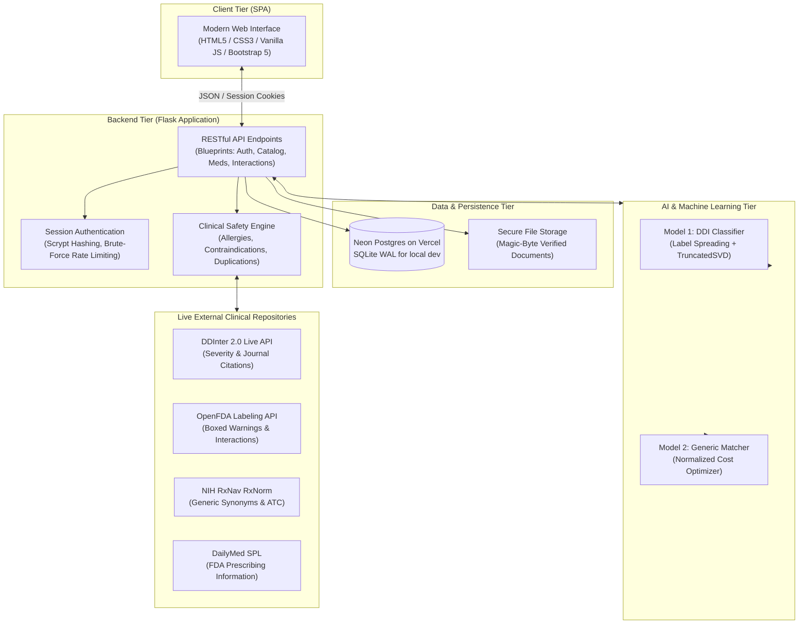

# MediSafe: Intelligent Clinical Decision Support & Medication Safety System

[](https://www.python.org/)
[](https://flask.palletsprojects.com/)
[%20%7C%20Postgres%20(Vercel)-green.svg)](https://neon.tech/)
[](https://vercel.com/new/clone?repository-url=https%3A%2F%2Fgithub.com%2Fpretomsid%2Fmedisafe&project-name=medisafe)
[](#license)

**MediSafe** is an intelligent Clinical Decision Support System (CDSS) designed to enhance patient safety by intercepting adverse drug-drug interactions, detecting therapeutic duplications, screening patient-specific allergies/contraindications, recommending cost-effective bioequivalent alternative medicines, and managing encrypted medical records.

MediSafe uniquely bridges local, offline machine learning models with live, authoritative global medical repositories—including **DDInter 2.0**, **OpenFDA**, **NIH RxNav**, and **DailyMed**—providing clinicians and patients with verified clinical management strategies and primary journal citations for every detected interaction.

---

## Table of Contents

- [Key Capabilities](#key-capabilities)
- [System Architecture](#system-architecture)
- [Machine Learning & Clinical AI Models](#machine-learning--clinical-ai-models)
  - [Model 1: Semi-Supervised Drug Interaction Risk Prediction](#model-1-semi-supervised-drug-interaction-risk-prediction)
  - [Model 2: Bioequivalent Alternative Medicine & Price Optimization](#model-2-bioequivalent-alternative-medicine--price-optimization)
  - [Rule-Based Clinical Safety Screening](#rule-based-clinical-safety-screening)
- [Prescription Reading (AI)](#prescription-reading-ai)
- [Live Clinical APIs Integration](#live-clinical-apis-integration)
- [Directory Layout](#directory-layout)
- [Installation & Quick Start](#installation--quick-start)
- [Database & Seed Data](#database--seed-data)
- [Deploying to Vercel](#deploying-to-vercel)
- [Testing & Quality Assurance](#testing--quality-assurance)
- [API Reference](#api-reference)
- [Security & Clinical Decision Disclaimer](#security--clinical-decision-disclaimer)
- [License & Acknowledgments](#license--acknowledgments)

---

## Key Capabilities

1. **Multi-Tier Drug-Drug Interaction (DDI) Analysis:**
   - **Tier 1 (Verified Clinical Warnings):** Ground truth interaction database sourced from DDInter 2.0 (130,422 curated interactions across Major, Moderate, and Minor severities).
   - **Tier 2 (Real-Time Live Clinical APIs):** Live queries to DDInter 2.0 (`https://ddinter.scbdd.com/`) and U.S. FDA Drug Labeling API, returning actionable clinical management advice and peer-reviewed literature citations (PubMed / DOI).
   - **Tier 3 (Semi-Supervised ML Risk Prediction):** Graph-based semi-supervised Label Spreading model estimating interaction risk for uncharacterized and novel drug pairs.
   - **Tier 4 (Official Monograph Documentation):** Parsing indications, warnings, and drug-class interactions directly from clinical generic monographs.
   - **Conservative Clinical Safety Principle:** The absence of evidence is **never** labeled as "Safe"—unknown drug combinations are always classified as *Unknown / Insufficient Information*.

2. **Therapeutic Duplication Interception:**
   - Detects multiple commercial brand names containing identical active pharmaceutical ingredients (e.g., co-prescribing *Napa* and *Ace*, both containing Paracetamol), preventing accidental toxic overdosing.

3. **Patient-Specific Safety Screening:**
   - Cross-references prescribed medicines against the patient's recorded allergies (e.g., penicillin cross-hypersensitivity with amoxicillin) and existing chronic medical conditions against contraindicated drug monographs.

4. **Normalized Bioequivalent Alternative Medicine Search:**
   - Exact-match generic substitution engine identifying all chemically identical alternatives (matching active ingredient, strength, and dosage form).
   - Standardizes pharmaceutical pricing across divergent packaging formats (e.g., price per tablet, per mL, or per gram) to highlight cost-saving opportunities without compromising clinical efficacy.

5. **Personal Medical Record & Medication Tracking:**
   - Secure digital record vault supporting lab reports and prescriptions with strict magic-byte file signature validation.
   - Comprehensive medication regimen management with automated safety audits upon schedule updates.

---

## System Architecture



---

## Machine Learning & Clinical AI Models

### Model 1: Semi-Supervised Drug Interaction Risk Prediction
- **Dataset:** DDInter 2.0 (`data/ddinter/`, covering all 8 ATC classification groups: A, B, D, H, L, P, R, V).
  - 160,235 unique drug interaction pairs across 1,939 drugs.
  - 130,422 labeled pairs (Major: 26,914 $\rightarrow$ `high`; Moderate: 96,675 $\rightarrow$ `moderate`; Minor: 6,833 $\rightarrow$ `low`).
  - 29,813 uncharacterized pairs labeled as `Unknown`.
- **Topological Representation:**
  - 32-dimensional SVD topological embeddings derived from the drug-drug co-interaction adjacency graph.
  - Leave-one-out historical drug risk profiles prevent label leakage.
  - Symmetric vector combinations ($A+B = B+A$) ensuring invariant order predictions.
- **Algorithm:** `sklearn.semi_supervised.LabelSpreading` using a precomputed, symmetric $k$-Nearest Neighbors ($k$-NN) graph. Information propagates from confirmed interactions across structural manifold manifolds to predict unverified pairs with calibrated probabilities.
- **Production Artifact:** Serialized to `model1/models/interaction_risk_model.json` (sub-millisecond evaluation in pure Python without runtime scikit-learn dependency).

### Model 2: Bioequivalent Alternative Medicine & Price Optimization
- **Dataset:** 21,712 commercial pharmaceutical products and 1,711 generic active ingredients from the Directorate General of Drug Administration (DGDA) / MedEx dataset.
- **Algorithm:** Content-based multi-attribute exact matching:
  $$\text{Eligible}(P, Q) \iff \text{Generic}(P) = \text{Generic}(Q) \land \text{Strength}(P) = \text{Strength}(Q) \land \text{FormGroup}(P) = \text{FormGroup}(Q)$$
- **Price Normalization:** Resolves package-size discrepancies (e.g., 60 mL suspension vs. 100 mL bottle) by computing unit prices ($\text{BDT} / \text{tablet}$, $\text{BDT} / \text{mL}$, $\text{BDT} / \text{gm}$). Products are ranked by price differential relative to the selected reference medicine.

### Rule-Based Clinical Safety Screening
- **Therapeutic Duplication:** Evaluates intersection sets of active ingredient keys: $|ia \cap ib| > 0$.
- **Allergy Screening:** Keyword and class matching (e.g., `penicillin` alert triggers on `Amoxicillin`, `Ampicillin`, and `Penicillin V`).
- **Condition Screening:** Patient medical history (e.g., *Hypertension*, *Renal impairment*) cross-matched against generic contraindications and clinical precautions.

---

### Prescription Reading (AI)

Uploading a **Prescription** now does real work instead of just storing a file:

Three ways to get the medicines in, all optional and the first one is completely free:

1. **Free, no key (default):** the photo is read **in your browser** with Tesseract.js (OCR), and only the recognised text is sent to the server, which finds medicine names by matching them against the 21,712-brand catalog (`backend/app/ai/text_match.py`). Strength, frequency and duration are picked from the same line. Works well on **printed** prescriptions (JPG/PNG); handwriting and PDFs are not reliable here.
2. **Free Gemini key (better for handwriting and PDFs):** set `GEMINI_API_KEY` (get one free at aistudio.google.com/apikey, no card). Note that Google's free tier may use submitted content to improve its products, so do not use it with real patient data.
3. **Claude key (paid):** set `ANTHROPIC_API_KEY` (`PRESCRIPTION_MODEL` to change the model). Used only if no Gemini key is set.
4. **Manual (always available, no photo and no key):** the yellow **Type medicines manually** button on Medical Records. Write one medicine per line (brand or generic, optional strength and frequency); unknown names are kept. It goes through the same review and safety check. You can also choose "Store only (manual)" when uploading, or add medicines under My Medications.

Whatever reads the file, the result is a suggestion:

1. Each medicine is matched against the catalog to fill in its active ingredient.
2. You review the result on a confirmation screen, edit or untick anything that was misread, then add the selected medicines to **My Medications** in one click.
3. Added medicines go through the same allergy, condition and drug-interaction screening as manually added ones. Medicines you already take are skipped, never duplicated.

The review screen also runs a **live safety analysis** while you edit it: the prescription medicines are checked against each other, your current medicines, your allergies and your conditions, before anything is added. The same analysis for everything you currently take is on the **Safety Report** page (`POST /api/interactions/report`). It has an automatic part (all your current medicines) and a manual part (type extra medicines to check without saving them). The default check is fast (verified database, monographs, AI model); an optional button adds slower live DDInter/OpenFDA lookups.

The AI only suggests; nothing is added without your confirmation. Uploaded files are now also stored in the database, so downloads keep working on serverless hosts.

---

## Live Clinical APIs Integration

MediSafe features an asynchronous clinical API adapter layer (`backend/app/ai/live_api.py`) with strict request timeouts (3.5s) and thread-safe caching:

| Repository / API | Provider | Clinical Utility | Integration Status |
| :--- | :--- | :--- | :--- |
| **DDInter 2.0 Live API** | SCBDD Group | Real-time severity, clinical management plans, primary literature journal citations (PubMed/DOI) | 🟢 Active |
| **OpenFDA Drug Labeling** | U.S. FDA | Official Boxed Warnings, contraindications, and laboratory test interferences | 🟢 Active |
| **NIH RxNav RxNorm** | U.S. NLM / NIH | International Nonproprietary Name (INN) $\leftrightarrow$ USAN synonym mapping and ATC drug classes | 🟢 Active |
| **DailyMed SPL API** | U.S. NLM / NIH | Direct links to FDA structured product labels and full prescribing monographs | 🟢 Active |

---

## Directory Layout

```
medisafe/
├── app.html                       # Authenticated Patient & Clinician Dashboard SPA
├── auth.html                      # Sign In, Sign Up, & Account Recovery Portal
├── index.html                     # Public Landing Page & Feature Overview
├── assets/                        # Static UI Assets
│   ├── css/style.css              # Custom Medical Design System
│   └── js/
│       ├── api.js                 # Centralized Frontend-Backend API Client Layer
│       ├── app.js                 # SPA Navigation, State Management & Event Handlers
│       ├── auth.js                # Authentication Validation & Cookie Handling
│       └── mock-data.js           # Development Reference Fixtures
├── api/                           # Vercel Serverless Entrypoint (Flask app + bundled demo DB)
│   ├── index.py                   # Builds the app with Vercel config, /api/health
│   ├── medisafe.db                # Seed DB (catalog + demo account only)
│   └── requirements.txt           # Serverless dependencies (incl. psycopg2)
├── scripts/
│   └── migrate_to_hosted_db.py    # Copies the seed DB into Postgres (Neon)
├── backend/                       # Primary Backend Web Service
│   ├── app/
│   │   ├── __init__.py            # Flask App Factory & Route Registration
│   │   ├── auth.py                # User Registration, Authentication & Scrypt Hashing
│   │   ├── config.py              # Environment Configuration & Security Keys
│   │   ├── interactions.py        # DDI Pipeline (Verified, Live, ML, Documented)
│   │   ├── models.py              # SQLAlchemy Schema (User, Med, Record, Catalog)
│   │   ├── routes.py              # Business Logic (Catalog, Profile, Meds, Records)
│   │   ├── safety.py              # Allergy, Condition & Duplication Screening Engine
│   │   ├── seed.py                # Database Ingestion & Data Pipeline CLI
│   │   └── ai/                    # AI Integration Adapters
│   │       ├── interaction_adapter.py # Model 1 ML Inference Engine
│   │       ├── live_api.py        # DDInter 2.0, OpenFDA & RxNav API Adapters
│   │       └── model2_adapter.py  # Model 2 Alternative Medicine Ranker
│   ├── instance/
│   │   └── medisafe.db            # Local development SQLite Database (WAL Mode Enabled)
│   ├── tests/
│   │   └── test_api.py            # Automated Pytest Suite (17 Unit & Security Tests)
│   ├── README.md                  # Backend Technical Documentation
│   ├── requirements.txt           # Python Production Dependencies
│   └── run.py                     # Primary Application Server Entrypoint
├── model1/                        # Drug Interaction Risk Machine Learning
│   ├── data/ddinter/              # Raw DDInter 2.0 Curated Interaction CSVs
│   ├── models/                    # Exported JSON Model Weights & Metrics
│   ├── download_ddi.py            # Dataset Ingestion with SHA-256 Checksums
│   ├── drug_names.py              # INN / USAN Name Standardization Table
│   ├── model1_interaction_risk.ipynb # Exploratory Data Analysis & Training Notebook
│   ├── train_interaction.py       # Label Spreading Training & Evaluation Pipeline
│   └── README.md                  # Machine Learning Technical Specifications
├── model2/                        # Alternative Medicine & Price Optimization
│   ├── medicine.csv               # 21,712 Commercial Pharmaceutical Formulations
│   ├── generic.csv                # 1,711 Active Generic Monographs
│   ├── models/                    # Exported Content-Based Match JSON Tables
│   ├── model2_alternative_medicine.ipynb # Price Distribution & Unit Standardization EDA
│   ├── price_units.py             # Packaging Normalization Logic
│   └── train.py                   # Alternative Match Precomputation Pipeline
├── docs/                          # Design docs and the 180-second video script
└── backup_pre_fastapi_migration/  # Safe Historical Rollback Snapshots & Logs
```

---

## Installation & Quick Start

### Prerequisites
- Python 3.10, 3.11, or 3.12
- SQLite 3.35+ (standard with modern Python builds) for local development; Neon Postgres is used for the Vercel deployment

### 1. Clone the Repository
```bash
git clone https://github.com/your-username/medisafe.git
cd medisafe
```

### 2. Configure Python Virtual Environment
```bash
cd backend
python3 -m venv .venv
source .venv/bin/activate       # On Windows: .venv\Scripts\activate
pip install --upgrade pip
pip install -r requirements.txt
```

### 3. Start the MediSafe Server
```bash
python run.py
```
The server will bind to `http://127.0.0.1:5000`.

### 4. Open in Your Browser
Open your web browser and navigate to:
```
http://127.0.0.1:5000
```
- Click **Sign In** or **Register** to explore the patient dashboard.
- Default testing account:
  - **Email:** `demo@medisafe.test`
  - **Password:** `Medisafe123`

---

## Database & Seed Data

The database (`backend/instance/medisafe.db`) comes pre-seeded with:
- **21,712** commercial pharmaceutical products.
- **1,711** generic drug monographs.
- **50,357** known clinical drug-drug interactions.
- A demo account (`demo@medisafe.test`) with a sample medical history.

To rebuild or re-import the database from raw CSV sources:
```bash
cd backend
.venv/bin/flask --app run import-data
```

To test external medical API connectivity from the terminal:
```bash
cd backend
.venv/bin/flask --app run check-live-apis
```

---

## Deploying to Vercel

The live site runs as a single Vercel project (repo root) with the Flask app served from `api/index.py` (`pyproject.toml` sets `entrypoint = "api.index:app"`). Only one Vercel project should be connected to this repository; `backend/`, `model1/` and `model2/` are bundled into that one function and must not be deployed separately.

**Persistent storage is required.** Vercel serverless instances only have a temporary `/tmp`, so a SQLite file there is lost on cold starts and is not shared between instances. New accounts would then disappear. The live deployment uses **Neon Postgres** (serverless Postgres, connected through Vercel's Storage tab):

1. In the Vercel project, add a Postgres database (Storage tab). This sets `DATABASE_URL` / `POSTGRES_URL`.
2. Add a long random `SECRET_KEY` environment variable (optional: `GEMINI_API_KEY` for server-side prescription reading, see Prescription Reading) (same value on every instance, otherwise session cookies are rejected).
3. Load the seed data once:
   ```bash
   DATABASE_URL="postgresql://..." python scripts/migrate_to_hosted_db.py
   ```
4. Redeploy, then open `/api/health`. It should report `"persistent_storage": true`.

Without `DATABASE_URL` the app falls back to ephemeral SQLite (demo account works, new accounts are not durable) and `/api/health` says so. Uploaded record files are stored in the database as well, so they survive serverless restarts (10 MB limit per file).

---

## Testing & Quality Assurance

MediSafe includes both automated unit tests and full end-to-end integration test suites:

### 1. Automated Pytest Suite
Verifies authentication workflows, password strength policies, magic-byte file validation, rate limiting, and safety screening:
```bash
cd backend
.venv/bin/pytest -q
```
*Expected Result:* `17 passed`

### 2. Live System End-to-End Verification
Tests full system integration against a live running server (authentication, catalog queries, Model 1 DDI predictions, Model 2 alternative suggestions, document uploads, and session termination):
```bash
# Ensure server is running on port 5000 in another terminal
python scratch/test_live_system.py http://127.0.0.1:5000
```
*Expected Result:* `33 PASSED, 0 FAILED`

---

## API Reference

All requests and responses use standard `application/json` with cookie-based session management (`credentials: include`).

| Method | Endpoint | Description | Auth Required |
| :--- | :--- | :--- | :--- |
| `POST` | `/api/auth/register` | Create a new user profile | No |
| `POST` | `/api/auth/login` | Authenticate and issue secure session cookie | No |
| `POST` | `/api/auth/logout` | Terminate active user session | Yes |
| `GET` | `/api/user` | Retrieve authenticated user profile, allergies, and conditions | Yes |
| `PUT` | `/api/user` | Update clinical profile, biometric data, and allergy list | Yes |
| `GET` | `/api/catalog` | Search medicines by brand, active ingredient, or dosage form | Yes |
| `GET` | `/api/catalog/<id>/live` | Retrieve live OpenFDA boxed warnings and RxNorm attributes | Yes |
| `POST` | `/api/interactions/check` | Execute multi-tier DDI check with live literature citations | Yes |
| `GET` | `/api/alternatives/<id>` | Retrieve bioequivalent generics ranked by normalized price | Yes |
| `GET` | `/api/meds` | List active and historical medications | Yes |
| `POST` | `/api/meds` | Add new medication (triggers automated safety screening) | Yes |
| `DELETE`| `/api/meds/<id>` | Remove medication from tracking list | Yes |
| `GET` | `/api/records` | List uploaded medical reports and prescriptions | Yes |
| `POST` | `/api/records` | Upload medical document with magic-byte file verification | Yes |
| `GET` | `/api/records/<id>/file`| Stream secure medical document file | Yes |
| `GET` | `/api/notifications` | Fetch safety alerts, duplication warnings, and system notices | Yes |
| `GET` | `/api/model-info` | Return real-time status of Model 1, Model 2, and external APIs | Yes |

---

## Security & Clinical Decision Disclaimer

### Security Implementations
- **Cryptographic Security:** Passwords hashed with `scrypt` (via Werkzeug security).
- **Session Protection:** Encrypted session cookies with `HttpOnly`, `SameSite=Lax`, and configurable `Secure` flags.
- **Brute-Force Rate Limiting:** Automatic 15-minute lockouts after 5 consecutive failed login attempts per IP/Email.
- **Magic-Byte Signature Verification:** Uploaded medical files are verified by inspecting binary headers (`%PDF-`, PNG, JPEG signatures), preventing arbitrary file execution or extension spoofing.
- **Resource Protection:** Maximum upload size strictly capped at 10 MB with sanitization of stored filenames.

### Clinical Disclaimer
> [!IMPORTANT]
> **MediSafe is an educational and clinical decision support tool, not a diagnostic or prescribing authority.**
> Predictions generated by machine learning models are statistical estimates. Absence of an interaction warning between two pharmaceutical agents does **not** guarantee clinical safety. Healthcare providers and patients must always exercise independent clinical judgment and consult official prescribing monographs.

---

## License & Acknowledgments

- **MediSafe Codebase:** Released for academic and research purposes under the MIT License.
- **DDInter 2.0 Data:** Computational Biology & Drug Design Group, Central South University (CC BY-NC-SA 4.0).
- **MedEx Bangladesh Dataset:** Directorate General of Drug Administration (DGDA) pharmaceutical catalog.
- **OpenFDA & DailyMed:** Public domain data provided by the U.S. Food and Drug Administration and the National Library of Medicine.
